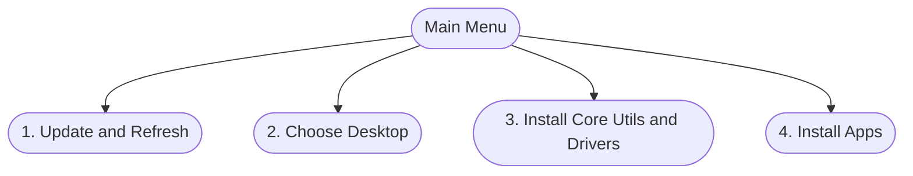
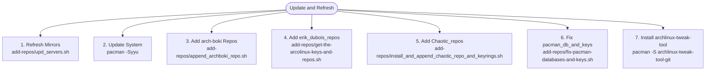
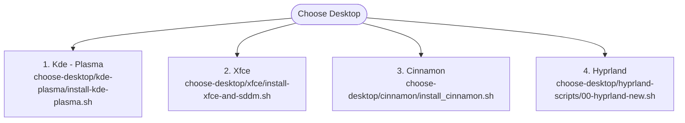
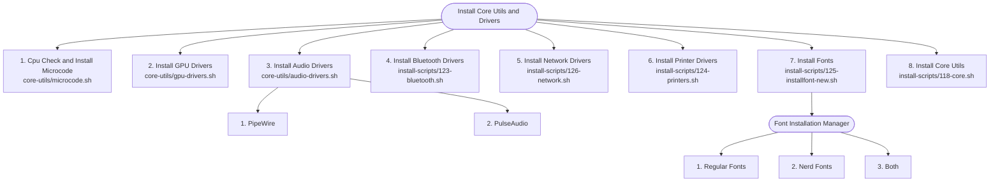
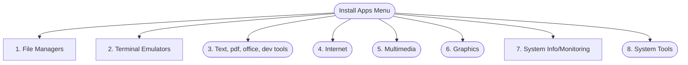
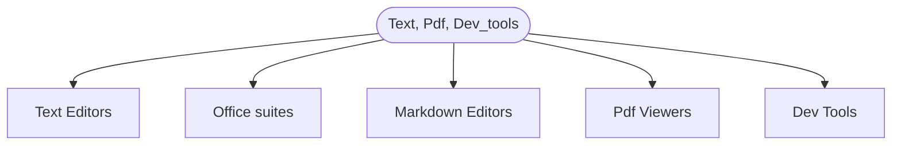
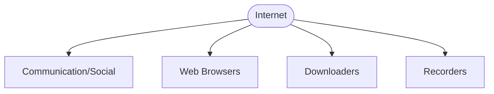
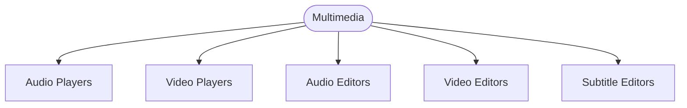
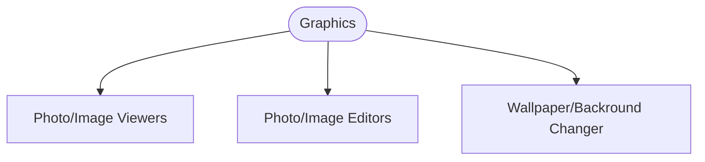
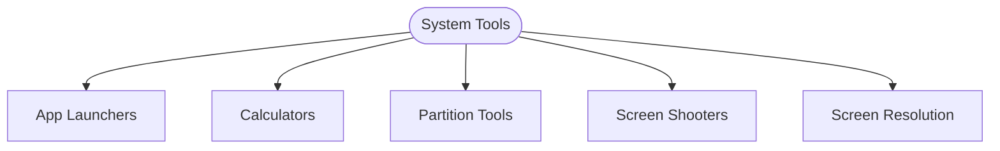

# Menu map of `03.arch-boki-post-install-gum.sh`

Source: [bojanstrkovski-21/arch-boki-post-install-dev](https://github.com/bojanstrkovski-21/arch-boki-post-install-dev) `master`.

This is only the gum entry point and the menus it opens. `01`, `02`, `04`, and the Python GUI are earlier tries and are not part of this map.

Before the first menu, the script runs `sudo pacman -S gum --needed --noconfirm`, clears the screen, and prints the ARCH BOKI banner with `gum style`. Then it loops the Main Menu.

Run it from the repo root. Every action uses a path like `./add-repos/...`.

## How a choice moves

- A choice marked **menu** clears the screen and opens the next menu. It stays on that menu.
- A choice marked **action** runs a script or a `pacman` / `yay` command, waits for Enter, then shows the same menu again.
- **Back to Main Menu** on a `03` submenu does not leave that submenu. It starts a new `./03.arch-boki-post-install-gum.sh` on top. Quitting that copy brings the submenu back.
- **Quit** runs `exit` and ends that process.
- **4. Install Apps** is the exception on the Main Menu. It runs the apps script and then `exit`s `03` with that script's status. You do not return to the Main Menu from it.
- Inside the apps script, **Back to install_apps** starts `130-archboki-install-apps.sh` again. **Main Menu** starts `03` again. Both sit on top of the menu you were already in.

Only three places open a further menu: the four Main Menu branches, the audio prompt, the font manager, and the apps script.

The charts in this file are Mermaid `flowchart TD`, which draws top to bottom. A rounded node is a menu. A square node is a script, a command, or the last screen before a package table. Back, Main Menu, and Quit are left off every chart.

```text
03 Main Menu
├── 1 Update and Refresh          menu, 9 choices, all leaves
├── 2 Choose Desktop              menu, 6 choices, all leaves
├── 3 Core Utils and Drivers      menu, 10 choices
│   ├── 3 Audio Drivers           action, then a 1/2 prompt
│   └── 7 Fonts                   menu
│       ├── 1 Regular Fonts       pick list
│       ├── 2 Nerd Fonts          pick list
│       └── 3 Both                regular pick list, then nerd pick list
├── 4 Install Apps                menu (separate script)
│   ├── 1 File Managers           menu of install actions
│   ├── 2 Terminal Emulators      menu of install actions
│   ├── 3 Text, pdf, office, dev  menu
│   │   ├── Text editors
│   │   ├── Office suites
│   │   ├── Markdown editors
│   │   ├── Pdf viewers
│   │   └── Dev tools
│   ├── 4 Internet                menu
│   │   ├── Communication
│   │   ├── Web browsers
│   │   ├── Downloaders
│   │   └── Recorders
│   ├── 5 Multimedia              menu
│   │   ├── Audio players
│   │   ├── Video players
│   │   ├── Audio editors
│   │   ├── Video editors
│   │   └── Subtitle editors
│   ├── 6 Graphics                menu
│   │   ├── Photo viewers
│   │   ├── Photo editors
│   │   └── Wallpaper changers
│   ├── 7 System Info             menu of install actions
│   └── 8 System Tools            menu
│       ├── App launchers
│       ├── Calculators
│       ├── Partition tools
│       ├── Screen shooters
│       └── Screen resolution
└── 5 Quit
```

## Main Menu

Function `main_menu` in `03.arch-boki-post-install-gum.sh`.



| # | On screen | Opens |
| --- | --- | --- |
| 1 | Update and Refresh | menu `update_and_refresh` |
| 2 | Choose Desktop | menu `choose_desktop` |
| 3 | Install Core Utils and Drivers | menu `install_core_utils` |
| 4 | Install Apps | `install-scripts/130-archboki-install-apps.sh`, then `03` exits |
| 5 | Quit Arch-Boki post install | `exit 0` |

Anything else prints `Invalid option!` and waits for Enter.

## 1. Update and Refresh

Menu title on screen: **Update and Refresh**. Loop `update_and_refresh`. No choice here opens another menu.



| # | On screen | Kind | Where it goes |
| --- | --- | --- | --- |
| 1 | Refresh Mirrors | action | `add-repos/upd_servers.sh`. That file is `sudo pacman -Syyv`. |
| 2 | Update System | action | `sudo pacman -Syyu` in `03`. |
| 3 | Add arch-boki Repos | action | `add-repos/append_archboki_repo.sh`. Appends `[shtrkce-repo]` (`https://bojanstrkovski-21.github.io/$repo/$arch`) and `[shtrkce_repo_xl]` (`https://gitlab.com/bojanstrkovski-21/$repo/-/raw/main/$arch`) to `/etc/pacman.conf`. Both are `SigLevel = Optional TrustAll`. Then `pacman -Syy`. |
| 4 | Add erik_dubois_repos | action | `add-repos/get-the-arcolinux-keys-and-repos.sh`. Function name in `03` is `add_arco_linux_repos`. The ArcoLinux repo blocks in that file are commented out. Live code appends `[nemesis_repo]`, `SigLevel = Never`, server `https://erikdubois.github.io/$repo/$arch`, then `pacman -Syy`. |
| 5 | Add Chaotic_repos | action | `add-repos/install_and_append_chaotic_repo_and_keyrings.sh`. Receives Chaotic key `3056513887B78AEB`, installs `chaotic-keyring` and `chaotic-mirrorlist`, appends `[chaotic-aur]` with `Include = /etc/pacman.d/chaotic-mirrorlist`, then `pacman -Syy`. |
| 6 | Fix pacman_db_and_keys | action | `add-repos/fix-pacman-databases-and-keys.sh`. If `8.8.8.8` answers, installs `archlinux-keyring`. Wipes `/var/lib/pacman/sync/*` and `/etc/pacman.d/gnupg/*`, runs `pacman-key --init` and `--populate`, adds the Ubuntu keyserver, then `pacman -Sy`. |
| 7 | Install archlinux-tweak-tool (add nemesis repo first!) | action | `sudo pacman -S archlinux-tweak-tool-git` in `03`. No `--needed` and no `--noconfirm`. |
| 8 | Back to Main Menu | nested `03` | Starts `./03.arch-boki-post-install-gum.sh` again. This menu is still underneath. |
| 9 | Quit Arch-Boki post install | exit | Ends this process. |

## 2. Choose Desktop

Menu title on screen: **Choose Desktop**. Loop `choose_desktop`. No choice here opens another menu. Each install waits for Enter, then this menu shows again.



| # | On screen | Script | What that script installs |
| --- | --- | --- | --- |
| 1 | Kde - Plasma | `choose-desktop/kde-plasma/install-kde-plasma.sh` | `neovim`, `sublime-text-4`, `xed`, the `plasma` group, `sddm`, `sddm-conf`, an explicit KF6 package list, the `qt6` group, `kvantum`, and KDE apps (kdeconnect, dolphin, gwenview, okular, spectacle, ark, kate, konsole, kcalc, kde-sdk tools). `kdenlive` is commented out. Then `systemctl enable --now sddm` and `systemctl start --now sddm`. |
| 2 | Xfce | `choose-desktop/xfce/install-xfce-and-sddm.sh` | `xfce4`, `xfce4-goodies`, artwork, screensaver, `mugshot`, `accountsservice`, `sddm`, `sddm-conf`, `neovim`, `sublime-text-4`, `xed`, Arco/Arch-Boki themes and wallpapers, `archboki-xfce-git`, `xfce4-panel-profiles`, `xfce4-docklike-plugin`. Then `systemctl enable sddm.service --now`. |
| 3 | Cinnamon | `choose-desktop/cinnamon/install_cinnamon.sh` | `cinnamon`, translations, `gnome-screenshot`, `gnome-system-monitor`, `gnome-terminal`, `xfce4-terminal`, `iso-flag-png`, `mintlocale`, `nemo-fileroller`, editors, `mugshot`, `accountsservice`, `sddm`, `sddm-conf`, and the same theme set as Xfce. Then `systemctl enable sddm.service --now`. |
| 4 | Hyprland | `choose-desktop/hyprland-scripts/00-hyprland-new.sh` | One `yay -S --noconfirm --needed` per package: Hyprland plus hypridle, hyprlock, hyprpicker, hyprpolkitagent, hyprshell, hyprshot, hyprsunset, waybar, swaync, swww, walker, rofi-wayland, portals, and a large app/font stack (terminals, firefox, brave, thunar, neovim, obs, gimp, sddm, rustup). No display manager is enabled. `yay` must already be installed. |
| 5 | Back to Main Menu | nested `03` | Same nesting as menu 1 choice 8. |
| 6 | Quit Arch-Boki post install | exit | |

## 3. Install Core Utils and Drivers

Menu title on screen: **Install Core Utils and Drivers**. Loop `install_core_utils`.

Choices 3 and 7 open another prompt. The rest are single actions.



| # | On screen | Kind | Where it goes |
| --- | --- | --- | --- |
| 1 | Cpu Check and Install Microcode | action | `core-utils/microcode.sh` |
| 2 | Install GPU Drivers | action | `core-utils/gpu-drivers.sh` |
| 3 | Install Audio Drivers | action, then a prompt | `core-utils/audio-drivers.sh` |
| 4 | Install Bluetooth Drivers | action | `install-scripts/123-bluetooth.sh` |
| 5 | Install Network Drivers | action | `install-scripts/126-network.sh` |
| 6 | Install Printer Drivers | action | `install-scripts/124-printers.sh` |
| 7 | Install Fonts | menu | `install-scripts/125-installfont-new.sh` |
| 8 | Install Core Utils | action | `install-scripts/118-core.sh` |
| 9 | Back to Main Menu | nested `03` | |
| 10 | Quit Arch-Boki post install | exit | |

### 3.1 Microcode

`core-utils/microcode.sh` has no menu. It reads `lscpu` Vendor ID.

- `GenuineIntel` installs `intel-ucode`
- `AuthenticAMD` installs `amd-ucode`
- anything else prints the vendor and exits 1

The install command is `pacman -Syu --noconfirm`, so the system upgrades as part of this choice. The initramfs is not rebuilt.

### 3.2 GPU drivers

`core-utils/gpu-drivers.sh` has no menu. It looks at `lspci` for a VGA or 3D line that mentions nvidia or amd, and uses field 5 as the vendor.

- NVIDIA installs `nvidia-dkms nvidia-utils nvidia-settings`
- AMD installs `xf86-video-amdgpu`
- anything else exits 1

Same `pacman -Syu` upgrade behavior. No Intel path.

### 3.3 Audio drivers

`core-utils/audio-drivers.sh`. If `jack2` is installed it is removed with `pacman -Rdd` before the prompt.

On screen:

```text
Which audio system would you like to install?
1) PipeWire
2) PulseAudio
Enter your choice (1 or 2):
```

| # | Choice | What it does |
| --- | --- | --- |
| 1 | PipeWire | `pacman -Rdd` removes the PulseAudio stack and a wide alsa/gstreamer/ffmpeg set, then installs that multimedia set again plus `pipewire`, `pipewire-audio`, `pipewire-pulse`, `pipewire-alsa`, `pipewire-jack`, `pipewire-zeroconf`, `wireplumber`, `pavucontrol`. |
| 2 | PulseAudio | The reverse. Removes the PipeWire stack with `-Rdd`, then installs `pulseaudio`, `pulseaudio-alsa`, `pulseaudio-bluetooth`, `pulseaudio-equalizer`, `pulseaudio-jack`, `pulseaudio-zeroconf`, `pavucontrol`. |
| other | | Prints `Invalid choice. Exiting.` and exits 1. |

`-Rdd` skips dependency checks.

### 3.4 Bluetooth

`install-scripts/123-bluetooth.sh`. No menu.

Installs `pacutils`, then `pacinstall --resolve-conflicts=all` for `bluez`, `bluez-libs`, `bluez-utils`, `blueman`. Enables and starts `bluetooth.service`. Sets `AutoEnable=true` in `/etc/bluetooth/main.conf`.

### 3.5 Network

`install-scripts/126-network.sh`. No menu.

Removes `iptables` with `pacman -Rdd`, then installs `iptables-nft`, `networkmanager`, `networkmanager-openvpn`, `networkmanager-openconnect`, `network-manager-applet`, `nm-connection-editor`, `nftables`, `avahi`, `samba`, NFS packages, the `gvfs-*` backends, `nss-mdns`, `file-roller`, `webkit2gtk`. Does not enable NetworkManager.

### 3.6 Printers

`install-scripts/124-printers.sh`. No menu.

Installs `pacutils`, then `pacinstall` for `cups`, `cups-pdf`, `cups-browsed`, `cups-filters`, `bluez-cups`, `ghostscript`, `gsfonts`, `gutenprint`, `foomatic-db-gutenprint-ppds`, `libcups`, `system-config-printer`. Enables and starts `cups.service`.

### 3.7 Fonts

`install-scripts/125-installfont-new.sh` replaces the gum screen with its own menu. Title on screen: **Font Installation Manager**.

| # | On screen | Opens |
| --- | --- | --- |
| 1 | Install Regular Fonts | the regular-font pick list, then `pacman` |
| 2 | Install Nerd Fonts | the nerd-font pick list, then a GitHub zip download |
| 3 | Install Both (Regular Fonts + Nerd Fonts) | the regular pick list, then the nerd pick list |
| q | Quit | exits the font script and returns to the Core Utils menu in `03` |

On a pick list you can type:

- numbers separated by spaces, for example `1 3 5`
- `a` or `all` for every font on that list
- `b` to go back to Font Installation Manager
- `q` to quit the font script

After an install it asks for Enter, or `q` to quit.

#### Regular fonts

Installed with `sudo pacman -S --needed --noconfirm`, then `sudo fc-cache -f -v`.

| # | Package |
| --- | --- |
| 1 | `ttf-croscore` |
| 2 | `ttf-carlito` |
| 3 | `ttf-caladea` |
| 4 | `opendesktop-fonts` |
| 5 | `inter-font` |
| 6 | `ttf-opensans` |
| 7 | `terminus-font` |
| 8 | `freetype2` |
| 9 | `ttf-ms-fonts` |
| 10 | `ttf-mac-fonts` |
| 11 | `ttf-macedonian-ancient` |
| 12 | `ttf-macedonian-church` |
| 13 | `ttf-material-design-iconic-font` |
| 14 | `otf-font-awesome` |
| 15 | `ttf-font-awesome-6` |
| 16 | `noto-fonts` |
| 17 | `noto-fonts-cjk` |
| 18 | `noto-fonts-emoji` |
| 19 | `noto-fonts-extra` |
| 20 | `ttf-anonymous-pro` |
| 21 | `ttf-cascadia-code` |
| 22 | `ttf-dejavu` |
| 23 | `ttf-fantasque-sans-mono` |
| 24 | `ttf-fira-mono` |
| 25 | `ttf-fira-sans` |
| 26 | `ttf-fira-code` |
| 27 | `ttf-hack` |
| 28 | `ttf-hellvetica` |
| 29 | `ttf-jetbrains-mono` |
| 30 | `ttf-joypixels` |
| 31 | `ttf-roboto` |
| 32 | `ttf-roboto-mono` |
| 33 | `ttf-ubuntu-font-family` |

`wget` and `unzip` are installed first if they are missing. That check runs on the Nerd Font path.

#### Nerd fonts

Downloaded from `https://github.com/ryanoasis/nerd-fonts/releases/download/v3.4.0/<Name>.zip` into `$HOME/.local/share/fonts/<Name>`, then `fc-cache -f`. A font directory that already has files is skipped.

| # | Zip name |
| --- | --- |
| 1 | CascadiaCode |
| 2 | CascadiaMono |
| 3 | DejaVuSansMono |
| 4 | DroidSansMono |
| 5 | FantasqueSansMono |
| 6 | FiraCode |
| 7 | FiraMono |
| 8 | GeistMono |
| 9 | Hack |
| 10 | Iosevka |
| 11 | JetBrainsMono |
| 12 | Lilex |
| 13 | Meslo |
| 14 | Mononoki |
| 15 | NerFontsSymbolsOnly |
| 16 | Noto |
| 17 | Overpass |
| 18 | RobotoMono |
| 19 | SourceCodePro |
| 20 | SpaceMono |
| 21 | Ubuntu |
| 22 | UbuntuMono |
| 23 | UbuntuSans |
| 24 | VictorMono |

### 3.8 Core utils

`install-scripts/118-core.sh`. No menu. One `pacman -S --needed --noconfirm` of the base toolbox: `base`, `base-devel`, `linux-headers`, `dkms`, `git`, `cmake`, `devtools`, archiso and ISO tools, `fwupd`, `fzf`, `ripgrep`, `plocate`, `flatpak`, `yad`, `zenity`, `xdg-utils`, `udisks2`, and archive tools (`p7zip`, `unrar`, `unzip`, `unace`).

## 4. Install Apps

`03` prints **Installing Apps...** and runs `install-scripts/130-archboki-install-apps.sh`.

That script is a second gum menu. It sets:

- `MAIN_SCRIPT` to `../03.arch-boki-post-install-gum.sh`
- `THIS_SCRIPT` to itself

Every install line below is `sudo pacman -S --needed --noconfirm` unless the row says `yay`. After the command, the same submenu stays open. There is no Enter pause on these rows.

The last three rows of every apps submenu are the same:

- **Back to install_apps** starts `130` again
- **Main Menu** starts `03` again
- **Quit** exits the apps script, which also ends the `03` that launched it

### Install Apps Menu

Title on screen: **Install Apps Menu**.



| # | On screen | Opens |
| --- | --- | --- |
| 1 | File Managers | menu `file_managers` |
| 2 | Terminal Emulators | menu `terminal_emulators` |
| 3 | Text editors,pdf, office, dev_tools | menu `text_devt_office_pdf` |
| 4 | Internet | menu `internet` |
| 5 | Multimedia | menu `multimedia` |
| 6 | Graphics | menu `graphics` |
| 7 | System Info/Monitoring | menu `system_info` |
| 8 | System Tools | menu `system_tools` |
| 9 | Main Menu | starts `03` |
| 10 | Quit Arch-Boki post install | `exit 0` |

### 4.1 File Managers

Title: **File Managers**.

| # | On screen | Packages |
| --- | --- | --- |
| 1 | Nemo file manager | `nemo nemo-compare nemo-fileroller nemo-image-converter nemo-preview nemo-share` |
| 2 | PcmanFM-gtk3 | `pcmanfm-gtk3` |
| 3 | PcmanFM-qt | `pcmanfm-qt` |
| 4 | Thunar file manager | `thunar thunar-archive-plugin thunar-shares-plugin thunar-volman tumbler file-roller` |
| 5 | Nautilus - gnome files | `nautilus nautilus-share sushi nautilus-code-git nautilus-open-any-terminal` |
| 6 | Dolphin - Kde Plasma | `dolphin dolphin-plugins` |
| 7 | Yazi-Terminal | `yazi` |
| 8 | Ranger-Terminal | `ranger` |
| 9 | Back to install_apps | restarts `130` |
| 10 | Main Menu | starts `03` |
| 11 | Quit Arch-Boki install_apps | exit |

### 4.2 Terminal Emulators

Title: **Terminal Emulators**.

| # | On screen | Packages |
| --- | --- | --- |
| 1 | Alacritty | `alacritty alacritty-themes imagemagick libsixel lsix` |
| 2 | Ghostty | `ghostty libsixel imagemagick lsix` |
| 3 | Kitty | `kitty kitty-shell-integration libsixel lsix imagemagick` |
| 4 | tilix | `tilix` |
| 5 | Wezterm | `wezterm-nightly-bin imagemagick` |
| 6 | Xfce4-Terminal | `xfce4-terminal` |
| 7 | Back to install_apps | restarts `130` |
| 8 | Main Menu | starts `03` |
| 9 | Quit Arch-Boki install_apps | exit |

### 4.3 Text, pdf, office, dev tools

Title: **Text, Pdf, Dev_tools**. This menu only opens more menus.



| # | On screen | Opens |
| --- | --- | --- |
| 1 | Text editors | menu `text_editors` |
| 2 | Office suites | menu `office_suites` |
| 3 | Markdown editors | menu `markdown_editors` |
| 4 | Pdf viewers | menu `pdf_viewers` |
| 5 | Dev Tools | menu `devtools` |
| 6 | Back to install_apps | restarts `130` |
| 7 | Main Menu | starts `03` |
| 8 | Quit Arch-Boki install_apps | exit |

#### 4.3.1 Text Editors

Title: **Text Editors**.

| # | On screen | Packages |
| --- | --- | --- |
| 1 | Emacs | `emacs` |
| 2 | Geany | `geany geany-plugins` |
| 3 | Leafpad (Lxde) | `leafpad` |
| 4 | Mousepad (Xfce) | `mousepad` |
| 5 | Sublime-text-4 | `sublime-text-4` |
| 6 | Xed (Linux Mint) | `xed` |
| 7 | Back to install_apps | restarts `130` |
| 8 | Main Menu | starts `03` |
| 9 | Quit Arch-Boki install_apps | exit |

#### 4.3.2 Office suites

Title: **Office suites**.

| # | On screen | Packages |
| --- | --- | --- |
| 1 | LibreOffice | `libreoffice-fresh` |
| 2 | OnlyOffice | `onlyoffice` |
| 3 | Back to install_apps | restarts `130` |
| 4 | Main Menu | starts `03` |
| 5 | Quit Arch-Boki install_apps | exit |

#### 4.3.3 Markdown editors

Title: **Markdown Editors**.

| # | On screen | Packages |
| --- | --- | --- |
| 1 | Affine | `yay -S affine-bin` (no `--needed`, no `--noconfirm`) |
| 2 | Obsidian | `obsidian` |
| 3 | Qownnotes | `qownnotes` |
| 4 | Back to install_apps | restarts `130` |
| 5 | Main Menu | starts `03` |
| 6 | Quit Arch-Boki install_apps | exit |

#### 4.3.4 Pdf viewers

Title: **Pdf Viewers**.

| # | On screen | Packages |
| --- | --- | --- |
| 1 | Evince | `evince` |
| 2 | Okular | `okular` |
| 3 | Xpdf | `xpdf` |
| 4 | Xreader | `xreader` |
| 5 | Zathura | `zathura` |
| 6 | Back to install_apps | restarts `130` |
| 7 | Main Menu | starts `03` |
| 8 | Quit Arch-Boki install_apps | exit |

#### 4.3.5 Dev Tools

Title: **Dev Tools**.

| # | On screen | Packages |
| --- | --- | --- |
| 1 | Code | `code` |
| 2 | Meld | `meld` |
| 3 | Notepadqq | `notepadqq` |
| 4 | Pycharm-community-edition | `pycharm-community-edition` |
| 5 | Vscodium | `vscodium vscodium-marketplace` |
| 6 | Visual Studio Code | `visual-studio-code-bin` |
| 7 | Zed | `zed` |
| 8 | Back to install_apps | restarts `130` |
| 9 | Main Menu | starts `03` |
| 10 | Quit Arch-Boki install_apps | exit |

### 4.4 Internet

Title: **Internet**. This menu only opens more menus.



| # | On screen | Opens |
| --- | --- | --- |
| 1 | Communication/Social | menu `comunication` |
| 2 | Web browsers | menu `web_browsers` |
| 3 | Downloaders | menu `downloaders` |
| 4 | Recorders | menu `recorders` |
| 5 | Back to install_apps | restarts `130` |
| 6 | Main Menu | starts `03` |
| 7 | Quit Arch-Boki install_apps | exit |

#### 4.4.1 Communication

Title: **Comunication/Social**.

| # | On screen | Packages |
| --- | --- | --- |
| 1 | Discord | `discord` |
| 2 | Signal | `signal-desktop` |
| 3 | Telegram | `telegram-desktop` |
| 4 | Back to install_apps | restarts `130` |
| 5 | Main Menu | starts `03` |
| 6 | Quit Arch-Boki install_apps | exit |

#### 4.4.2 Web browsers

Title: **Web Browsers**.

| # | On screen | Packages |
| --- | --- | --- |
| 1 | Brave | `brave-bin` |
| 2 | Chromium | `chromium` |
| 3 | Firefox | `firefox` |
| 4 | Firefox-esr | `firefox-esr` |
| 5 | Google Chrome | `google-chrome` |
| 6 | Librewolf | `librewolf` |
| 7 | Qutebrowser | `qutebrowser` |
| 8 | Vivaldi | `vivaldi vivaldi-ffmpeg-codecs` |
| 9 | Back to install_apps | restarts `130` |
| 10 | Main Menu | starts `03` |
| 11 | Quit Arch-Boki install_apps | exit |

#### 4.4.3 Downloaders

Title: **Downloaders**.

| # | On screen | Packages |
| --- | --- | --- |
| 1 | Deluge-Gtk | `deluge-gtk` |
| 2 | Ktorrent | `ktorrent` |
| 3 | Qbittorrent | `qbittorrent` |
| 4 | Transmission-Gtk | `transmission-gtk` |
| 5 | Transmission-Qt | `transmission-qt` |
| 6 | Back to install_apps | restarts `130` |
| 7 | Main Menu | starts `03` |
| 8 | Quit Arch-Boki install_apps | exit |

#### 4.4.4 Recorders

Title: **Recorders**.

| # | On screen | Packages |
| --- | --- | --- |
| 1 | Gpu-screen-recorder-gtk | `gpu-screen-recorder gpu-screen-recorder-gtk` |
| 2 | Hyprshot (hyprland-onmly) | `hyprshot` |
| 3 | Kazam | `kazam` |
| 4 | Obs-studio | `obs-studio` |
| 5 | Peek | `peek` |
| 6 | Simplescreenrecorder | `simplescreenrecorder-qt6-git` |
| 7 | Back to install_apps | restarts `130` |
| 8 | Main Menu | starts `03` |
| 9 | Quit Arch-Boki install_apps | exit |

### 4.5 Multimedia

Title: **Multimedia**. This menu only opens more menus.



| # | On screen | Opens |
| --- | --- | --- |
| 1 | Audio Players | menu `audio_players` |
| 2 | Video Players | menu `video_players` |
| 3 | Audio Editors | menu `audio_editors` |
| 4 | Video Editors | menu `video_editors` |
| 5 | Subtitle Editors | menu `subtitle_editors` |
| 6 | Back to install_apps | restarts `130` |
| 7 | Main Menu | starts `03` |
| 8 | Quit Arch-Boki install_apps | exit |

#### 4.5.1 Audio Players

Title: **Audio Players**.

| # | On screen | Packages |
| --- | --- | --- |
| 1 | Amberol | `amberol` |
| 2 | Audacious | `audacious audacious-plugins` |
| 3 | Deadbeef | `deadbeef` |
| 4 | Elisa | `elisa` |
| 5 | G4music | `g4music-git` |
| 6 | juk | `juk` |
| 7 | lollypop | `lollypop` |
| 8 | Pragha | `pragha` |
| 9 | Rhythmbox | `rhythmbox` |
| 10 | Sayonara Player | `sayonara-player` |
| 11 | Strawberry | `strawberry` |
| 12 | Back to install_apps | restarts `130` |
| 13 | Main Menu | starts `03` |
| 14 | Quit Arch-Boki install_apps | exit |

#### 4.5.2 Video Players

Title: **Video Players**.

| # | On screen | Packages |
| --- | --- | --- |
| 1 | Celluloid | `celluloid` |
| 2 | Clapper | `clapper clapper-enhancers` |
| 3 | Kodi | `kodi` |
| 4 | Mpv | `mpv` |
| 5 | Smplayer | `smplayer smplayer-skins smplayer-themes` |
| 6 | Vlc media player | `vlc` plus the `vlc-plugin-*` set in that case line (codecs, inputs, and outputs) |
| 7 | Back to install_apps | restarts `130` |
| 8 | Main Menu | starts `03` |
| 9 | Quit Arch-Boki install_apps | exit |

#### 4.5.3 Audio Editors

Title: **Audio Editors**. Openshot is on this menu.

| # | On screen | Packages |
| --- | --- | --- |
| 1 | Ardour | `ardour` |
| 2 | Audacity | `audacity` |
| 3 | Kwave | `kwave` |
| 4 | Lmms | `lmms` |
| 5 | Openshot | `openshot` |
| 6 | soundconverter | `soundconverter` |
| 7 | reaper | `reaper reapack sws` |
| 8 | tenacity | `tenacity` |
| 9 | Back to install_apps | restarts `130` |
| 10 | Main Menu | starts `03` |
| 11 | Quit Arch-Boki install_apps | exit |

#### 4.5.4 Video Editors

Title: **Video Editors**.

| # | On screen | Packages |
| --- | --- | --- |
| 1 | flowblade | `flowblade` |
| 2 | handbrake | `handbrake` |
| 3 | kdenlive | `kdenlive` |
| 4 | losslesscut | `losslesscut-bin` |
| 5 | makemkv | `makemkv mkvtoolnix-cli mkvtoolnix-gui` |
| 6 | Openshot | `openshot` |
| 7 | Shotcut | `shotcut` |
| 8 | Back to install_apps | restarts `130` |
| 9 | Main Menu | starts `03` |
| 10 | Quit Arch-Boki install_apps | exit |

#### 4.5.5 Subtitle Editors

Title: **Subtitle Editors**.

| # | On screen | Packages |
| --- | --- | --- |
| 1 | Aegisub | `aegisub` |
| 2 | Subtitleedit | `subtitleedit` |
| 3 | Subtitlecomposer | `subtitlecomposer` |
| 4 | Back to install_apps | restarts `130` |
| 5 | Main Menu | starts `03` |
| 6 | Quit Arch-Boki install_apps | exit |

### 4.6 Graphics

Title: **Graphics**. This menu only opens more menus.



| # | On screen | Opens |
| --- | --- | --- |
| 1 | Photo/Image Viewers | menu `photo_viewers` |
| 2 | Photo/Image Editors | menu `photo_editors` |
| 3 | Wallpaper/Backround Changer | menu `wallpaper_changer` |
| 4 | Back to install_apps | restarts `130` |
| 5 | Main Menu | starts `03` |
| 6 | Quit Arch-Boki install_apps | exit |

#### 4.6.1 Photo viewers

Title: **Photo/Image Viewers**.

| # | On screen | Packages |
| --- | --- | --- |
| 1 | Darktable | `darktable` |
| 2 | Ephoto | `ephoto` |
| 3 | GPicView | `gpicview` |
| 4 | Gwenview | `gwenview` |
| 5 | Nomacs | `nomacs` |
| 6 | Nsxiv | `nsxiv` |
| 7 | Qimgv | `qimgv-git` |
| 8 | Ristretto | `ristretto` |
| 9 | Back to install_apps | restarts `130` |
| 10 | Main Menu | starts `03` |
| 11 | Quit Arch-Boki install_apps | exit |

#### 4.6.2 Photo editors

Title: **Photo/Image editors**.

| # | On screen | Packages |
| --- | --- | --- |
| 1 | Gimp | `gimp` |
| 2 | Gpick | `gpick` |
| 3 | Inkscape | `inkscape` |
| 4 | Krita | `krita` |
| 5 | Pinta | `pinta` |
| 6 | RawTherapee | `rawtherapee` |
| 7 | Upscayl | `upscayl-desktop-git upscayl-models-desktop` |
| 8 | Back to install_apps | restarts `130` |
| 9 | Main Menu | starts `03` |
| 10 | Quit Arch-Boki install_apps | exit |

#### 4.6.3 Wallpaper

Title: **Wallpaper/Backround Changer**.

| # | On screen | Packages |
| --- | --- | --- |
| 1 | Azote(nwg creators) | `azote` |
| 2 | Feh(terminal) | `feh` |
| 3 | Hyprpaper(hyprland) | `hyprpaper` |
| 4 | Nitrogen | `nitrogen` |
| 5 | Swaybg(terminal-wayland | `swaybg` |
| 6 | Swww(terminal) | `swww` |
| 7 | Variety | `variety` |
| 8 | Waypaper(wayland-x11-gui) | `waypaper-git` |
| 9 | Xwallpaper(terminal) | `xwallpaper` |
| 10 | Back to install_apps | restarts `130` |
| 11 | Main Menu | starts `03` |
| 12 | Quit Arch-Boki install_apps | exit |

### 4.7 System Info/Monitoring

Title: **System Info/Monitoring**. No further menu.

| # | On screen | Packages |
| --- | --- | --- |
| 1 | Bashtop | `bashtop` |
| 2 | Btop | `btop` |
| 3 | Countryfetch | `countryfetch` |
| 4 | Cpufetch | `cpufetch` |
| 5 | Fastfetch | `fastfetch` |
| 6 | Glances | `glances` |
| 7 | Gtop | `gtop` |
| 8 | Htop | `htop` |
| 9 | Hyfetch | `hyfetch` |
| 10 | Mission Center | `mission-center` |
| 11 | Nvtop | `nvtop` |
| 12 | Resources | `resources` |
| 13 | Stacer | `yay -S --needed --noconfirm stacer-bin` |
| 14 | Xfce4-Taskmanager | `xfce4-taskmanager` |
| 15 | Back to install_apps | restarts `130` |
| 16 | Main Menu | starts `03` |
| 17 | Quit Arch-Boki install_apps | exit |

### 4.8 System Tools

Title: **System Tools**. This menu only opens more menus.



| # | On screen | Opens |
| --- | --- | --- |
| 1 | App Launchers | menu `app_launchers` |
| 2 | Calculators | menu `calculators` |
| 3 | Partition tools | menu `partition_tools` |
| 4 | Screen Shooters | menu `screen_shooters` |
| 5 | Screen Resolution Setters | menu `screen_resolution` |
| 6 | Back to install_apps | restarts `130` |
| 7 | Main Menu | starts `03` |
| 8 | Quit Arch-Boki install_apps | exit |

#### 4.8.1 App Launchers

Title: **App Launchers**.

| # | On screen | Packages |
| --- | --- | --- |
| 1 | Bemenu | `bemenu` |
| 2 | Bemenu-Wayland | `bemenu-wayland` |
| 3 | Dmenu(it is better to clone and build) | `dmenu` |
| 4 | Fuzzel | `fuzzel` |
| 5 | Rofi | `rofi` |
| 6 | Rofi-Wayland | `rofi-wayland` |
| 7 | Tofi | `tofi` |
| 8 | Walker | `walker-bin` |
| 9 | Wofi | `wofi` |
| 10 | Back to install_apps | restarts `130` |
| 11 | Main Menu | starts `03` |
| 12 | Quit Arch-Boki install_apps | exit |

#### 4.8.2 Calculators

Title: **Calculators**.

| # | On screen | Packages |
| --- | --- | --- |
| 1 | Galculator | `galculator` |
| 2 | Gnome Calculator | `gnome-calculator` |
| 3 | Qalculate-Gtk | `qalculate-gtk` |
| 4 | Qalculate-Qt | `qalculate-qt` |
| 5 | Back to install_apps | restarts `130` |
| 6 | Main Menu | starts `03` |
| 7 | Quit Arch-Boki install_apps | exit |

#### 4.8.3 Partition tools

Title: **Partition Tools**.

| # | On screen | Packages |
| --- | --- | --- |
| 1 | Kde Partition Manager | `partitionmanager` |
| 2 | Gnome Disks Utility | `gnome-disk-utility` |
| 3 | Gparted | `gparted` |
| 4 | Back to install_apps | restarts `130` |
| 5 | Main Menu | starts `03` |
| 6 | Quit Arch-Boki install_apps | exit |

#### 4.8.4 Screen shooters

Title: **Screen Shooters**.

| # | On screen | Packages |
| --- | --- | --- |
| 1 | Flameshot | `flameshot` |
| 2 | Kazam | `kazam` |
| 3 | Ksnip | `ksnip` |
| 4 | Shutter | `shutter` |
| 5 | Spectacle | `spectacle` |
| 6 | Xfce4-screenshooter | `xfce4-screenshooter` |
| 7 | Back to install_apps | restarts `130` |
| 8 | Main Menu | starts `03` |
| 9 | Quit Arch-Boki install_apps | exit |

#### 4.8.5 Screen resolution

Title: **Screen Resolution**.

| # | On screen | Packages |
| --- | --- | --- |
| 1 | Arandr(gui x11) | `arandr` |
| 2 | nwg-displays(hyprland-sway-nwg-shell only) | `nwg-displays` |
| 3 | wdisplays(gui wayland) | `wdisplays` |
| 4 | wlr-randr(cli wayland) | `wlr-randr` |
| 5 | xorg-xrandr(cli x11) | `xorg-xrandr` |
| 6 | Back to install_apps | restarts `130` |
| 7 | Main Menu | starts `03` |
| 8 | Quit Arch-Boki install_apps | exit |

## Scripts `03` actually calls

These are the only scripts on the path. Anything else in the repo is unused by this menu.

| Script | Reached from |
| --- | --- |
| `add-repos/upd_servers.sh` | Main → 1 → 1 Refresh Mirrors |
| `add-repos/append_archboki_repo.sh` | Main → 1 → 3 Add arch-boki Repos |
| `add-repos/get-the-arcolinux-keys-and-repos.sh` | Main → 1 → 4 Add erik_dubois_repos |
| `add-repos/install_and_append_chaotic_repo_and_keyrings.sh` | Main → 1 → 5 Add Chaotic_repos |
| `add-repos/fix-pacman-databases-and-keys.sh` | Main → 1 → 6 Fix pacman_db_and_keys |
| `choose-desktop/kde-plasma/install-kde-plasma.sh` | Main → 2 → 1 Kde - Plasma |
| `choose-desktop/xfce/install-xfce-and-sddm.sh` | Main → 2 → 2 Xfce |
| `choose-desktop/cinnamon/install_cinnamon.sh` | Main → 2 → 3 Cinnamon |
| `choose-desktop/hyprland-scripts/00-hyprland-new.sh` | Main → 2 → 4 Hyprland |
| `core-utils/microcode.sh` | Main → 3 → 1 Microcode |
| `core-utils/gpu-drivers.sh` | Main → 3 → 2 GPU Drivers |
| `core-utils/audio-drivers.sh` | Main → 3 → 3 Audio Drivers |
| `install-scripts/123-bluetooth.sh` | Main → 3 → 4 Bluetooth |
| `install-scripts/126-network.sh` | Main → 3 → 5 Network |
| `install-scripts/124-printers.sh` | Main → 3 → 6 Printers |
| `install-scripts/125-installfont-new.sh` | Main → 3 → 7 Fonts |
| `install-scripts/118-core.sh` | Main → 3 → 8 Core Utils |
| `install-scripts/130-archboki-install-apps.sh` | Main → 4 Install Apps |

Commands that live inside `03` and are not a separate script: `pacman -S gum`, `pacman -Syyu`, and `pacman -S archlinux-tweak-tool-git`.

`130` does not call any other script. Every apps choice is an inline `pacman` or `yay` line. The font script and the audio script also stay inside their own file.
